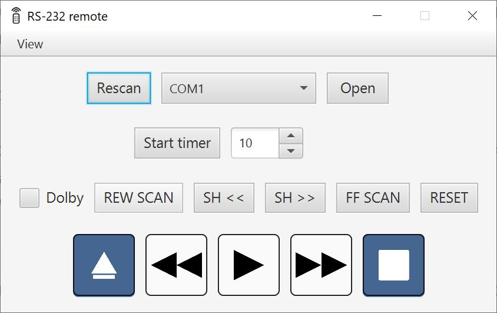
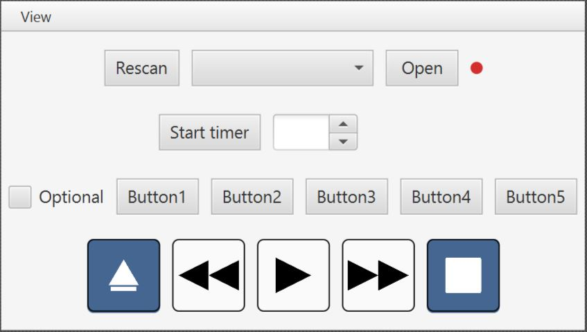
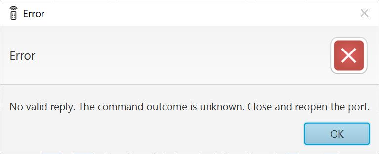

# Overview

This is a software RS-232 remote aimed towards VCRs that don't have proper RS-422 connection

# Features

* **Automatic port opening & closing**
* **Built-in timer function**
* **5 user-defined buttons + 1 checkbox**
* **User-editable commands for all buttons**
* **Adapter availability indicator beside the COM port selector**

# Setup and usage

This remote's default layout uses _Sony UVW-1200_ Betacam SP VCR command set. 

User editable settings are stored in **config.properties**

The default button order is:

## Customization

In order to use customize this program you need to:

1. **Set up user buttons:**
   * _buttonX_name_ is a button **display name** (where X - is a button number)
   * _buttonX_cmd_ is a **button command** (where X - is a button number)

2. **Set up user checkbox:**
    * user checkbox **asserts RTS**
    * _optional1_name_ is a checkbox **display name**
    * _optional1_engaged_ set up checkbox status _(checked/unchecked)_ be default

3. **Redefine basic commands**

## Timer setup

This remote has a resettable timer which allows for delayed _STOP_ command. It allows to stop a VCR remotely after a fixed time interval and should be used with a timer in capture software to end the recording around that point. 

Timer has a **default value of 10 minutes** and displays remaining time in **_H:mm_ format**.

Timer can be set in range between **1** and **360** **minutes** with 1 minute increment. You can enter the number manually or by **scrolling a mouse wheel**.

## Error handling

The dot beside the COM port selector is green when the ATmega IR adapter replies to a heartbeat and red before the first reply, after a failed heartbeat, or when the port is closed. Its tooltip also describes the status.

While a port is open and idle, the app sends one PING byte (`0x05`) every 3 seconds and expects PONG (`0x07`) within 50 ms. Missed replies turn the dot red and retry silently on the next tick. Probes pause while a remote command is in flight, including the long eject sequence; existing command ACK (`0x06`), NAK (`0x15`) and five-second timeout behavior remain. Controls are disabled while an exchange is pending.

Selected port will be opened **automatically** if you press any button. You will get a message if port can't be opened, there's an issue with output stream, etc.

For example:

